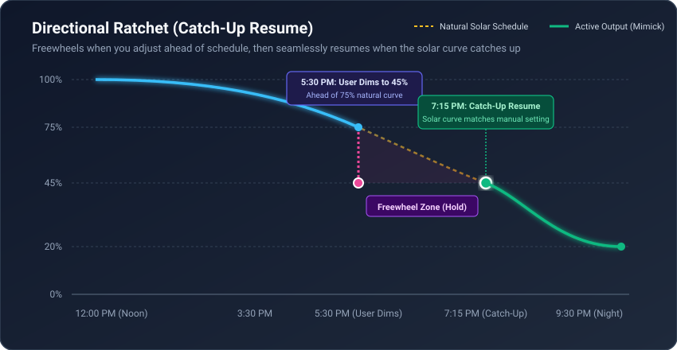

# Mimick

[](https://github.com/hacs/default)
[](https://github.com/kiddyfurby/mimick/releases)
[](https://www.home-assistant.io/)
[](https://opensource.org/licenses/MIT)

A lean, robust, and highly customizable circadian lighting integration for [Home Assistant](https://www.home-assistant.io/).

---

## 🎯 Project Goal

The core mission of **Mimick** is three-fold:
* ☀️ **Mimic Outdoor Light in the Daytime**: Seamlessly match the crisp, natural color temperature and ambient brightness streaming through your windows, with intelligent softening on cloudy days.
* 🧠 **Smart Blending with Manual Control**: Gracefully yield to wall dimmers, dashboard sliders, and virtual group controllers (like Lightener) using **Catch-Up Resume**—adapting with the user rather than fighting them.
* 🕯️ **Warm, Cozy Light at Night**: Never leave you in the dark; smoothly glide into relaxing candlelight tones (`2200K`) and comfortable evening brightness as the sun sets.

---

## 💡 Why Mimick?

Circadian lighting is one of the most rewarding smart home automations, but existing solutions often struggle in complex, real-world setups:

* **The Built-in [Flux](https://www.home-assistant.io/integrations/flux/) Integration**: While simple, Flux lacks modern UI configuration, does not support per-light customization, and frequently causes command bouncing and jerky transitions on modern Zigbee and Matter bulbs.
* **Upstream [Mimicking](https://github.com/basnijholt/adaptive-lighting)**: While pioneering, its reliance on low-level service call interceptors and continuous 45-second background transitions often leads to:
  * **Turn-Off Lockups**: Certain Zigbee fixtures (such as Aqara bulbs with JN5169 microcontrollers) do not abort active hardware transition timers on `OnOff.off()`, leaving bulbs dimly glowing or causing them to be falsely turned back on.
  * **Turn-On Flashes**: Service call interception can result in bulbs flashing at full power or old color temperatures before snapping to target values.
  * **Group Controller Conflicts**: Intercepting calls globally breaks virtual brightness curve controllers like [Lightener](https://github.com/fredrik-ersgard/lightener).
  * **All-or-Nothing Overrides**: Touching a dimmer switch often meant fighting the automation or disabling adaptation entirely for the rest of the night.

**Mimick** was built from scratch to solve these challenges with clean, modern Home Assistant architecture, full UI-based configuration, and human-centric features like **Catch-Up Resume**.

---

## ✨ Key Features

### 🔄 Catch-Up Resume (Directional Ratchet)
In traditional systems, manually dimming a light either starts a tug-of-war with the automation or disables adaptation completely, leaving the light bright all night.

**Catch-Up Resume** acts like a bicycle freewheel mechanism:
* **Evening Dimming**: If you manually dim a light ahead of schedule (e.g., from 75% down to 45% at 5:30 PM), Mimick **freewheels and holds your 45% setting**. As the sun continues to set, the natural curve descends. The instant the solar target reaches 45%, the ratchet clicks back into gear and seamlessly continues dimming the light down to your evening baseline.
* **Morning Brightening**: If you wake up early and crank the lights up to 80%, it holds steady until the morning daylight curve catches up to 80%, then smoothly drives the lights up to the midday peak.
* **Works on Both Channels**: Applied independently to **brightness** and **color temperature**. Manually dimming the brightness never prevents the color from continuing its natural transition to warm amber.

<p align="center">
  
</p>

```text
Brightness (%)
100% ┼               ╭───────╮ (Midday Peak)
     │              ╭╯       ╰╮
 75% ┼─────────────╭╯         ╰─ ─ ─ ─ ─ ─ (5:30 PM: User dims early to 45%)
     │            ╭╯            ╲
 45% ┼───────────╭╯              ●═══════════● (Catch-Up Point ~7:15 PM)
     │          ╭╯               Freewheeling ╰╮
 20% ┼─────────╭╯                              ╰────────────── (Evening Floor: 20%)
     ┼─────────┴──────────────────────────────────────────────
              Dawn             Noon           Sunset         Night
```

### ☀️ Natural Daylight Spectrum
Rather than arbitrary linear ramps, Mimick models the natural atmospheric Rayleigh scattering of daylight:
* **Night ($< -18^\circ$ Sun Elevation)**: Cozy, warm candlelight baseline (default `2200K`).
* **Dawn & Sunset ($0^\circ$ on Horizon)**: Warm golden hour (`2600K`).
* **Morning & Afternoon ($+15^\circ$ to $+30^\circ$)**: Soft, energetic neutral white (`3400K – 4300K`).
* **Solar Noon ($+45^\circ$ to $+64^\circ$)**: Crisp, natural daylight (default `5500K`, customizable up to `6500K`) to match the cool light streaming through your windows.

### ⛅ Daytime Weather & Cloud Mimicking
* **Ambient Matching**: During peak daylight hours, cloud coverage or overcast skies (from a weather entity or outdoor lux sensor) gently soften indoor brightness (e.g., from 100% to 75%–85%) to match the moodier ambient light outside.
* **Pure Color Fidelity**: Weather modulation **only** affects brightness—it never yellows the daytime color temperature. Overcast window light is cool diffused daylight, and indoor lights match that spectrum cleanly.
* **Never Goes Dark**: As evening approaches, weather influence naturally fades to zero. The lights smoothly transition into warm evening mode without dipping below your minimum brightness floor.

### 🎛️ Group-Level & Light-Level Customization via UI
* Full UI configuration through **Settings** → **Devices & Services** (no YAML required).
* Configure **Group Defaults** (Min/Max Brightness, Min/Max Kelvin, Transition Speed, Update Interval, Sleep Mode Entity).
* Set **Light-Level Overrides**: Select any specific fixture in the group to override its brightness range, Kelvin range, or toggle brightness/color adaptation independently.

### 🤝 100% Compatible with Lightener & Group Controllers
Mimick uses native Home Assistant state tracking (`async_track_state_change_event`) rather than hijacking the core service dispatcher. Virtual group integrations like [Lightener](https://github.com/fredrik-ersgard/lightener) can turn on and dim child lights without interference or command drops.

### ⚡ Clean Turn-Off & Flash-Free Turn-On
* **Turn-On Staging**: Fast `0.5s` soft-start on initial turn-on eliminates chromatic snaps and cold-start driver flashes.
* **Safe Transitions**: Background adjustments use discrete, safe transitions (default `2.0s`, customizable up to `300s`) that finish immediately, avoiding hardware timer lockups on Zigbee bulbs.
* **Clean Turn-Off**: Turning off a fixture immediately cancels in-flight tasks and clears locks.

---

## 📦 Installation

### Option 1: HACS (Custom Repository)
1. In Home Assistant, open **HACS** → **Integrations**.
2. Click the three dots `...` in the top-right corner and select **Custom repositories**.
3. Add the repository URL: `https://github.com/kiddyfurby/mimick`
4. Category: **Integration**.
5. Click **Add**, find **Mimick**, and click **Download**.
6. Restart Home Assistant.

### Option 2: Manual Installation
1. Download the `custom_components/mimick` folder from this repository.
2. Copy it into your Home Assistant directory under:
   ```text
   config/custom_components/mimick/
   ```
3. Restart Home Assistant.

---

## 🚀 Setup & Configuration

### 1. Create an Mimick Group
1. Go to **Settings** → **Devices & Services** → **Add Integration**.
2. Search for **Mimick**.
3. Configure your group defaults:
   * **Group Name**: e.g. `Living Area`, `Bedrooms`, or `Downstairs`
   * **Lights**: Select all lights belonging to this group
   * **Min / Max Brightness**: e.g., `30%` – `100%`
   * **Min / Max Color Temperature**: e.g., `2200K` – `5500K`
   * **Adapt Brightness / Adapt Color**: Toggles for the group
   * **Transition Duration**: Default `2.0s` (safe, discrete transitions)
   * **Update Interval**: Default `90s`
   * **Weather Entity (Optional)**: Select a weather entity (e.g. `weather.home`) or cloud cover sensor
   * **Weather Modulation Influence**: Default `30%`
   * **Sleep Mode Entity (Optional)**: Select an `input_boolean` or `switch` to trigger night/sleep mode

---

### 2. Configure Light-Level Overrides (e.g. Dining Light with Lightener)
If you have a light with distinct hardware limits, or one controlled by Lightener:

1. Under **Settings** → **Devices & Services** → **Mimick**, click **Configure** on your group.
2. Select **Configure Light Overrides**.
3. Choose the fixture (e.g., `light.dining`).
4. Enable custom overrides:
   * Override specific **Min / Max Brightness** or **Min / Max Kelvin**.
   * Toggle **Adapt Brightness** or **Adapt Color** independently for that light.
5. Click **Submit**.

---

## 🎚️ Entities & Services

### Entities Created per Group
* **Switches**:
  * `switch.mimick_<name>` (Master group enable/disable)
  * `switch.mimick_<name>_adapt_brightness`
  * `switch.mimick_<name>_adapt_color`
  * `switch.mimick_<name>_sleep_mode`
* **Sensors**:
  * `sensor.mimick_<name>_target_brightness`
  * `sensor.mimick_<name>_target_color_temp`
  * `sensor.mimick_<name>_solar_factor`

### Services

#### `mimick.apply`
Immediately calculates and applies adaptive values to active lights.
```yaml
action: mimick.apply
data:
  entity_id:
    - light.living_1
    - light.dining
  force: true  # Force update even if manual override is held
```

#### `mimick.set_manual_control`
Manually hold or release adaptation for specific fixtures.
```yaml
action: mimick.set_manual_control
data:
  entity_id: light.living_1
  manual_control: false  # Immediately release lock and resume adaptation
```

---

## 📄 License

This project is licensed under the MIT License.
